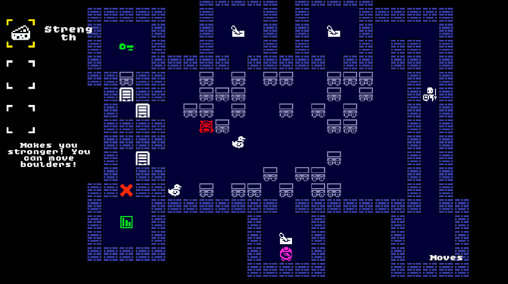

# 🗝️ Three Rules

A top-down, grid-based retro puzzle-adventure game built in Unity (C#). Reclaim three sacred relics hidden by the ancient rulers by surviving 10 increasingly difficult dungeon levels filled with deadly traps, enemy AI, and strict inventory puzzles.

### 🌐 Play on Itch.io: [https://milospavlovic7.itch.io/three-rules](https://milospavlovic7.itch.io/three-rules)



---

## 📜 The Three Core Rules

1. **Take the key.**
2. **Find the exit.**
3. **Don't die.**

---

## 🎮 How to Play

- **Movement**: `W`, `A`, `S`, `D` or Arrow Keys
- **Activate Item**: `Space`
- **Switch Active Items**: `1`, `2`, and `3`
- **Pause Menu**: `Esc`
- **Inventory Constraint**: You can carry a maximum of **3 items** at any given time (excluding the key). Choose what you carry wisely—some items are passive, while others require active timing.

---

## 👾 Enemies & Hazards

- **Patroler**: Patrols along a predetermined path with consistent timing. Time your movements to slip past.
- **Mimicker**: Intelligently copies your movements along the X-axis, Y-axis, or both. Use obstacles to misdirect them.
- **Lava**: Molten hazard that kills instantly upon contact.
- **Pink Lava**: Exotic high-temperature lava that kills instantly unless shielded by specialized gear.

---

## 🎒 Items & Power-Ups

- **🗝️ Key**: Mandatory artifact required to unlock the exit door in each level.
- **👢 Lava Boots**: Heat-resistant boots that allow safe passage over regular orange lava.
- **🥾 Pink Lava Boots**: Specialized boots that grant immunity while walking over pink lava.
- **💪 Strength**: Enhances your pushing power, allowing you to move heavy boulders onto pressure plates or into enemy paths.
- **👥 Echo Doll**: Deploys an echo decoy replica of the player to solve split-pressure puzzles and trigger mechanisms.
- **🔘 Pressure Plates**: Activates gates and mechanical doors when weighed down by a boulder, enemy, or player.

---

## 🚀 Quick Start

### Option 1: Play Online or Download (Itch.io)
Play directly or download standalone builds:  
👉 **[https://milospavlovic7.itch.io/three-rules](https://milospavlovic7.itch.io/three-rules)**

### Option 2: Open in Unity Editor
1. Clone the repository:
   ```bash
   git clone https://github.com/milospavlovic7/Unity-ThreeRules.git
   ```
2. Open Unity Hub and click **Add** -> select the cloned folder `Unity-ThreeRules`.
3. Launch the project (Unity 2022+ recommended).
4. Navigate to `Assets/Scenes` and open the start scene to test and play inside the editor.

---

## 🛠️ Tech Stack

- **Game Engine**: [Unity](https://unity.com/) (2D Grid & Physics)
- **Language**: C#
- **Art Style**: 1-bit retro pixel art aesthetic
- **Audio**: Custom Sound & Music Manager

---

## 📜 License

MIT License. Free for educational and personal use.
